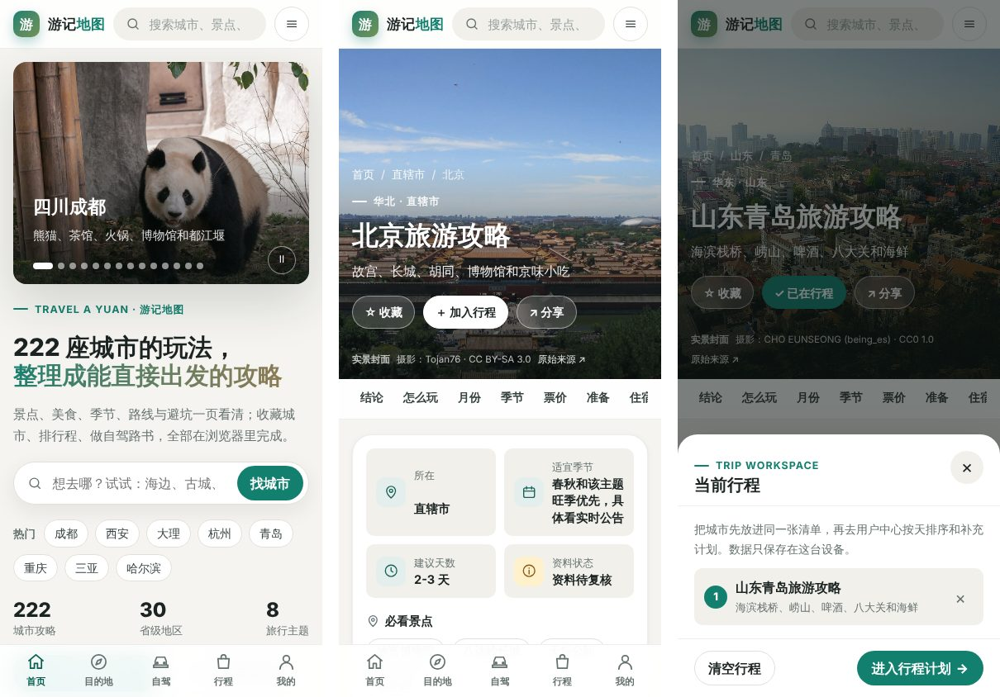

# 游记地图（Travel A Yuan）

覆盖全国 222 座城市的旅游攻略网站：景点、美食、季节、路线和避坑都整理成卡片，可以收藏城市、排行程、生成自驾路书，也能装到手机桌面离线看。网站在运行时是纯静态页面，不需要后端服务器。

## 访问地址

| 用途 | 地址 | 状态 |
| --- | --- | --- |
| 公开网站（GitHub Pages） | <https://shimmerjoe.github.io/youji-ditu/> | **还不能访问**：仓库是私有的，Pages 还没开启，见下文 [开启公开地址](#开启公开地址) |
| 城市攻略示例 | <https://shimmerjoe.github.io/youji-ditu/cities/beijing.html> | Pages 开启后可用 |
| 跨城市总览 | <https://shimmerjoe.github.io/youji-ditu/overview.html> | Pages 开启后可用 |
| 源码仓库 | <https://github.com/shimmerjoe/youji-ditu> | 私有 |
| 本机预览 | <http://localhost:8765/> | 运行 `npm run preview` 或双击 `scripts/windows/打开首页.bat` |

> 代码推送到仓库和网站上线是两件事：只有 Pages 开启并且 Actions 部署成功，上面的公开地址才能打开。上线前请先用本机预览检查。

## 界面预览

| 首页（桌面） | 城市攻略（桌面） |
| --- | --- |
|  |  |

手机版（首页、城市页、行程面板）：



## 功能一览

- **城市攻略页**：全幅实景封面，章节标签栏吸顶，正文开头有一张“一眼看懂”速览卡（所在地、适宜季节、建议天数、资料状态、必看、必吃）。Markdown 大纲会按内容类型渲染成不同组件：
  - 要点卡和场景卡：先看结论、半天 / 1 天 / 雨天 / 亲子怎么玩
  - 12 个月日历：当前月份自动高亮，手机上可横向滑动
  - 景点、季节、美食和票价卡片：详情较多时先折叠
  - 路线时间轴、避坑提示卡、地图分区标签
  - 出发前复核清单：可勾选，勾选状态按城市保存在本机
- **首页**：搜索框优先，下面依次是热门城市、编辑精选横滑、兴趣主题、按地区 / 季节 / 天数 / 主题 / 交通组合筛选、24 座精选城市和实用工具。
- **跨城市总览**（`overview.html`）：把 `记录.md` 整理成时间成本、场景、季节和多城路线索引。
- **导航**：桌面端点“选城市”展开省份面板；手机端顶部是抽屉菜单，底部有首页 / 目的地 / 自驾 / 行程 / 我的五个标签。全站搜索支持城市、景点、美食和季节，还会记住最近的搜索和浏览。
- **行程与用户中心**：收藏、浏览记录、行程排序与对比、自驾路书、清单、预算和笔记都只保存在当前浏览器，可以导出或导入 JSON 备份。
- **自驾路书**（`roadtrip.html`）：不配地图密钥也能离线估算里程、分天安排、预算和风险；配置高德 JS Key 后会切换成真实路网。
- **体验**：支持深色模式、字号和动效偏好、打印 / 另存 PDF；作为 PWA 可以离线缓存。

## 目录结构

```text
youji-ditu/
├─ README.md               项目说明（本文件）
├─ package.json            Node 构建与测试脚本
├─ vite.config.ts          Vite 构建配置（产物输出到 site/assets/）
├─ tsconfig.json
├─ content/                ← 攻略源内容（手写）
│  ├─ 城市/*.md            222 篇城市攻略 Markdown
│  └─ 记录.md              跨城市总览与更新记录
├─ frontend/               ← 前端源码（手写）
│  ├─ src/                 TypeScript：全站搜索、省份导航、联网状态（Vite 打包）
│  └─ runtime/             站点样式 travel.css 与交互脚本 travel.js
├─ tools/                  ← 生成器、校验、测试与维护脚本
│  ├─ build_travel_html.py 全站生成器（页面、索引、PWA、SEO）
│  ├─ project_paths.py     统一目录约定
│  ├─ site_icons.py        内联 SVG 图标
│  ├─ roadtrip-*.js/.css   自驾路书算法与界面
│  ├─ requirements-build.txt  Python 构建依赖（Pillow）
│  └─ test_*.py / *.test   自动化测试
├─ site/                   ← 网站目录（由生成器输出，提交进仓库，可直接预览）
│  ├─ index.html、overview.html、destinations.html、themes.html、city-guides.html、roadtrip.html、tools.html、user.html
│  ├─ cities/*.html        城市攻略页
│  ├─ assets/              样式、脚本、搜索索引、城市封面与图片库及其授权记录
│  └─ manifest.webmanifest、sw.js、sitemap.xml、robots.txt
├─ scripts/windows/        Windows 一键预览、重建、补图、推送脚本
├─ docs/                   指南、体检报告、截图与历史记录
├─ backup/                 本地迁移快照的逐文件清单与比对说明
├─ app-capacitor/          可选的 Android 封装模板
└─ .github/workflows/      GitHub Pages 构建与部署
```

`dist/`、`node_modules/`、`artifacts/` 和 Python 缓存都是构建或本机产物，不提交进仓库。

## 本地运行

需要 Node.js 22 及以上版本和 Python 3.12 及以上版本。

```powershell
npm ci
python -m pip install -r tools/requirements-build.txt
npm run check      # Vite 构建 → 生成全站 → 类型检查 → Node/Python 测试 → 站内链接校验
npm run preview    # 在 http://localhost:8765/ 预览 site/
```

| 命令 | 作用 |
| --- | --- |
| `npm run build` | 用 Vite 打包 `frontend/src`，再用 Python 把 `content/` 生成到 `site/` |
| `npm test` | TypeScript 检查、16 项 Node 测试、144 项 Python 测试 |
| `npm run validate` | 检查 `site/` 中的失效链接、锚点、重复 ID 和缺失 alt |
| `npm run stage` | 按白名单把公开文件复制到 `dist/`，供 Pages 部署 |

Windows 用户可以直接双击 `scripts/windows/` 里的脚本：`打开首页.bat` 用于本机预览，`手机访问.bat` 用于局域网预览，`重新生成网页.bat` 用于重新生成网站。离线缓存、模块脚本和完整搜索都需要通过 HTTP 访问，直接双击 HTML 文件无法完整使用。

## 维护方式

- 修改攻略正文：编辑 `content/城市/*.md`，然后运行 `npm run build`。章节标题（如“核心景点”“美食总表”“全年月份速查”“路线模板”“避坑和取舍”“出发前复核清单”）决定正文用哪种组件显示。
- 新增城市：在 `content/城市/` 新建 `省份_城市.md`，必要时在 `tools/city-page-meta.json` 补充 slug 和简介。
- 修改样式或交互：编辑 `frontend/runtime/travel.css`、`frontend/runtime/travel.js`，或者 `frontend/src/*.ts`。不要直接修改 `site/assets/` 里的生成文件。
- 补充图片：放到 `site/assets/photos/城市slug/`，重新生成后会进入页面和内容体检。
- 图片审核：授权合规和内容适配是两道独立门槛。不合格的来源记录到 `site/assets/photo-editorial-decisions.json`，不要只删除本地文件。
- 资料复核：点城市页景点卡上的“查官网 / 地图 / 攻略”链接核对信息，再把确认后的链接写进 Markdown 的“来源参考”。
- 查看薄弱项：打开 [内容与图片体检](docs/reports/内容与图片体检.md)。

### 定向补图

自动搜索只刷新指定的城市，避免一次覆盖全部缓存：

```powershell
$env:TRAVEL_FETCH_COMMONS = "1"
$env:TRAVEL_FETCH_CITY_KEYS = "beijing,tianjin"
python -X utf8 tools\build_travel_html.py
Remove-Item Env:TRAVEL_FETCH_COMMONS, Env:TRAVEL_FETCH_CITY_KEYS
```

如果已经在 Wikimedia Commons 人工选好了文件，先不带 `--apply` 预检一遍元数据，确认无误后再写入：

```powershell
python -X utf8 tools\import_commons_city_photo.py --city beijing --source "https://commons.wikimedia.org/wiki/File:Example.jpg"
python -X utf8 tools\import_commons_city_photo.py --city beijing --source "https://commons.wikimedia.org/wiki/File:Example.jpg" --apply
```

导入器会校验 Commons 文件页、JPEG 尺寸、横向比例、许可证和作者，但不能代替人眼判断图片是否切题。导入后还要重新生成网站，检查桌面和手机上的裁切效果。

## 开启公开地址

仓库已经包含 `.github/workflows/pages.yml`：每次推送到 `main`，GitHub Actions 会自动执行 `npm ci → npm run check → npm run stage`，再把 `dist/` 部署到 Pages。要让公开地址可以访问，需要仓库所有者完成以下步骤：

1. **可见性**：免费账号的私有仓库不能使用 Pages。需要把仓库改为 Public（Settings → General → Danger Zone → Change visibility），或者升级到 GitHub Pro 等支持私有 Pages 的方案。
2. **开启 Pages**：在 Settings → Pages → Build and deployment 中，把 Source 选为 **GitHub Actions**。
3. **触发部署**：把本分支合并到 `main`，或者在 Actions 页手动运行 “Build, verify, and deploy GitHub Pages”。
4. **About 信息**：在仓库首页右侧 About 的齿轮里，把 Website 填为 `https://shimmerjoe.github.io/youji-ditu/`，并勾选“Use your GitHub Pages website”；Topics 可填 `travel`、`travel-guide`、`china`、`pwa`、`itinerary-planner`、`static-site`。
5. **验收**：等部署成功后打开 <https://shimmerjoe.github.io/youji-ditu/>，用桌面和手机各检查一遍首页、城市页、搜索和行程面板。公开地址核验之前，发布状态只能记为“未验证”。

如果公开地址发生变化，构建前用环境变量 `TRAVEL_PUBLIC_URL` 覆盖默认地址，不要把本地路径写进 canonical 或分享元数据。

### 发布流程

每次维护后，先在本地完成生成、测试和浏览器检查，再审查差异。只有本次变更得到明确授权、远端凭据可用，并且确认不会夹带其他工作时，才做选择性提交和发布：

1. 运行 `npm run check`。
2. 用 `git status` 和 `git diff` 审查改动范围，只暂存本次相关的文件（不要一次性暂存全部改动），然后写清楚提交说明。没有明确授权时不推送。
3. 推送到 `main` 后等待 Actions 完成，再打开公开地址核对内容和移动端导航。如果发布失败，保留可恢复的源码并记录原因，不要拿本地预览代替公开验收。

## 数据、离线与隐私

- 收藏、浏览记录、行程、清单、预算、笔记和城市复核清单都只保存在当前浏览器的 localStorage 中。数据格式带版本号，支持迁移和 JSON 备份 / 恢复。
- 自驾路书的“分享链接”会把路书快照写进链接本身，不上传服务器，请只发给信任的人。
- Service Worker 第一次联网访问时会缓存应用外壳；断网打开未缓存的页面时，会显示明确的离线说明，不会冒充实时地图、天气或票价服务。
- 222 城的搜索索引在第一次输入搜索词时才加载，不会拖慢首屏。

## 内容与素材边界

- 外部攻略和社交平台只用来发现路线、主题和待核验的线索。票价、开放时间、预约和交通都以官方来源为准。
- 私人知识库、视频和下载目录只提供研究方法和候选线索，不直接把原文、受限图片、视频或第三方组件复制到公开网站。
- 图片必须同时满足两个条件才能公开使用：来源和授权字段可以追溯，并且通过了目的地内容适配审核。

## 自驾路书与地图配置

`roadtrip.html` 默认离线可用。如果需要真实地图、路网里程、预计耗时和道路收费：

1. 在高德开放平台创建“Web 端（JS API）”应用，拿到 JS Key 和安全密钥，并把可用域名限制为实际的预览 / 发布域名。
2. 构建前设置 `TRAVEL_AMAP_JS_KEY` 和 `TRAVEL_AMAP_SECURITY_CODE` 两个环境变量，再运行 `npm run build`。
3. 通过 HTTP 预览地图，不能直接双击 HTML 文件。没有设置这两个变量时，页面不会请求地图 SDK。

Web 端 JS Key 和安全密钥会出现在静态 HTML 里，这是浏览器端地图 SDK 的工作方式，所以必须依赖域名白名单来防止滥用。不要提交或内联高德 Web 服务私钥。

## 更多文档

- [文档索引](docs/README.md)
- [便携运行与开发](docs/guides/便携运行说明.md)
- [手机、PWA 与 APK](docs/guides/移动端与APK说明.md)
- [资料来源与更新规则](docs/guides/资料来源与更新规则.md)
- [内容与图片体检](docs/reports/内容与图片体检.md)
