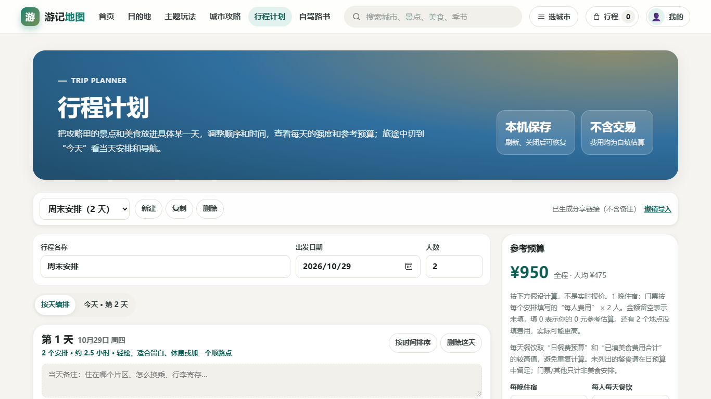
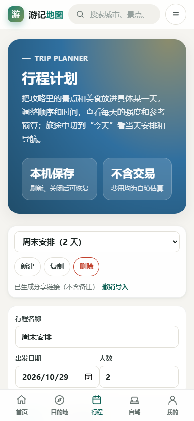

# 2026-10-29 自主迭代指令与执行记录

## 现场状态

- 起点：`main` 的 `4302376503167c409e4d18ec9311b67771ed4026`；工作分支：`codex/travel-ten-rounds-20261029`。
- 当前仓库公开，Pages 已启用，最近部署成功。沿用 `content/` → Python/Vite → `site/` → `dist/` 的静态 PWA 架构。
- 已检查 README、近期重构记录、构建与测试命令、行程数据模型/存储/选择器/界面及相关样式；全仓库路径清单与基线生成校验覆盖 222 城。
- 基线 `npm ci`、`npm run check` 通过：25 项 Node、162 项 Python，站内缺链/锚点/重复 ID/缺 alt 均为 0。
- Edge 真实浏览器检查首页、青岛、行程、用户中心、路书 × 桌面/手机：HTTP 200、无横向溢出或 pageerror。证据在本任务 audits 目录，不把抽查扩大为全城事实核验。
- 已复现：删天时 30 个安排被截成 20 个；无关 JSON `{foo:'bar'}` 被识别为行程。源码还显示存储读取异常、重复标识、分享缺少格式边界、时间与预算表达等缺口。

## 给自己执行的命令句

接管当前干净的任务分支，保留既有功能和视觉系统。以游客能可靠编排行程、保存恢复、带着计划出行为目标，执行下表至少十轮实质迭代。先处理已复现的数据丢失，再完善输入边界、故障反馈、排程和预算，不重复旧的布局重构，不编造旅游事实或实时数据，不引入不必要依赖。

每轮理解涉及的数据模型、调用方、序列化与界面，再改源码并补风险对应的回归测试。运行完整 check 和 stage，以 Edge 在桌面/手机操作该轮场景，保存机器结果与关键截图，复查差异后提交。生成产物通过构建更新。失败保留证据并修正；只有达到可验证的结果才填写完成。最终执行全流程与多视口回归，推送已授权的项目，核对 CI/Pages 和线上行为。未验证内容如实列出。

## 十轮目标与结果

| 轮次 | 目标 | 验收重点 | 状态 |
| --- | --- | --- | --- |
| 1 | 删除或跨天移动时不丢安排 | 超限删天/移动被拒绝；安排与备注不丢，成功删除可撤销。check：26 Node/162 Python；stage：231 页；Edge 1366/390 实测通过（round01） | 完成 |
| 2 | 修复重复日/条目标识 | 全行程标识去重；重复 ID 样本编辑第二项不误改第一项。check：27 Node/162 Python；stage/Edge 1366/390 通过（round02） | 完成 |
| 3 | 严格而可恢复的 JSON 导入 | 无关/混合无效/未来版本/超限文件整体拒收；合法备份可导入，原行程保留。check：28 Node/162 Python；stage/Edge 双视口通过（round03） | 完成 |
| 4 | 存储故障与旧数据修复反馈 | getItem/setItem 故障仍可临时编排并导出；备份结果如实显示；修复旧迁移会删除损坏原文的问题；用户中心拒绝空备份。check：31 Node/162 Python；stage/Edge 双视口通过（round04） | 完成 |
| 5 | 分享载荷与预览边界 | 检查编码/版本/结构与 16,000 字符上限，超限引导 JSON；预览独立 ID 且只读。check：32 Node/162 Python；stage/Edge 双视口通过（round05） | 完成 |
| 6 | 时间冲突与跨午夜提示 | 显示预计结束时间，检查重叠/顺序/跨午夜并导出提醒。check：33 Node/162 Python；stage/Edge 双视口通过（round06） | 完成 |
| 7 | 可编辑交通/休息留白 | 每项 0–240 分钟预留参与强度、重叠和跨午夜判断；刷新/分享/Markdown 保留，并明确不是实时通勤。check：34 Node/162 Python；stage/Edge 双视口通过（round07） | 完成 |
| 8 | 区分未填费用与已填 0 元 | 留空表示未知、填写 0 是明确金额；缺项提醒/分享/导出与旧数据兼容。check：35 Node/162 Python；stage/Edge 双视口通过（round08） | 完成 |
| 9 | 餐饮预算避免重复叠加 | 餐费取日预算/已填美食合计较高值；表格支持大额数字与键盘滚动，汇总/导出一致。check：36 Node/162 Python；stage/Edge 双视口通过（round09） | 完成 |
| 10 | 防止景点重复点击误添加 | 默认禁止重复添加，显示所在日期；勾选再次到访才允许，满天禁选；Esc 返回原按钮。check：37 Node/162 Python；stage/Edge 双视口通过（round10） | 完成 |
| 11 | 复查补充：备份失败与跨标签保护 | 未能备份损坏原值时拒绝覆盖；跨标签损坏保留本页 3 个安排并可导出。check：38 Node/162 Python；stage/Edge 双视口 22 个累计用例通过（round11） | 完成 |
| 12 | 发布复查：入口重复初始化 | 首页懒加载模块回引未带版本号的入口，导致重复提示节点/监听器；拆分纯数据工具、显式分块、启动幂等保护和构建回归检查。check：38 Node/163 Python；四视口发布回归与第 13 轮合并通过，运行时重复 ID 为 0 | 完成 |
| 13 | 发布复查：带参数行程离线刷新 | 行程自动写入 `?plan=` 后，原缓存无法匹配。仅 HTML 离线回退允许忽略查询参数，版本化脚本仍精确匹配；四视口离线编辑、刷新与未知页面 503 提示通过。check：38 Node/164 Python | 完成 |

## 证据与恢复

任务检查脚本和截图报告保存到 `D:/.AI/codex_tmp/audits/youji-20261029/`；可复用浏览器验收脚本放入 tools。中断后检查本文件、Git log 和未提交差异，从首个待执行轮次继续。

浏览器基线曾因通用服务器帮助器在 Windows 的后台服务行为出现超时/空响应。改用测试进程内的静默线程 HTTP 服务后通过；这是测试环境问题，未计作产品缺陷，也未隐藏错误。

发布验收中，图片检查初版未考虑轮播中隐藏图片的 CSS 可见性，收藏与用户中心定位也沿用了错误选择器；按当前 DOM 修正测试，未作为产品缺陷或完成轮次计数。第 12 轮最初只拆分源码仍被打包器合回入口，新增构建契约测试明确失败后，再设置纯工具分块并通过；参考 [Rolldown codeSplitting 官方文档](https://rolldown.rs/reference/OutputOptions.codeSplitting)。

## 最终验收

2026-10-30 本地验收：

- `npm run check`：构建、TypeScript、38 项 Node、164 项 Python 通过；231 个 HTML、222 篇城市源稿/页面，站内缺链、缺锚点、重复 ID、空文件、缺 alt 均为 0。
- `npm run stage`：231 个 HTML、378 张被引用图片进入部署目录。素材数量是构建盘点，不代表本轮重新逐张审核过图片。
- `python -X utf8 tools/travel_release_audit.py`：1920×1080、1366×768、390×844、360×800 四视口均通过搜索键盘操作/历史、收藏、导航、筛选 URL 与无结果、JSON 恢复、Markdown、分享接收与备注默认排除、打印入口/样式、路书生成保存恢复导出、离线编辑刷新、未缓存页面提示。联网阶段 pageerror、console error、请求失败和 HTTP 错误均为 0。
- `python -X utf8 tools/planner_browser_audit.py --round 11 --viewports 1920x1080,1366x768,390x844,360x800`：11 个累计场景 × 四视口，共 44 项通过；包括第 11 轮新增的跨标签损坏恢复。
- 截图覆盖首页、青岛、行程、用户中心、路书与离线行程。完整机器证据位于本机 audits，选定截图与精简报告随项目保存。

### 改动入口

- `frontend/src/trip-plan.ts`：容量与标识、导入/分享边界、时间冲突、交通预留、费用与餐饮口径。
- `frontend/src/plan-store.ts`、`frontend/runtime/travel.js`：安全读取、保留损坏原文、备份失败保护与真实导出反馈。
- `frontend/src/planner-page.ts`、`plan-picker.ts`、`frontend/runtime/travel.css`：操作反馈、跨标签保护、重复到访选择和窄屏预算。
- `frontend/src/recent-visits.ts`、`site-search.ts`、`home-continue.ts`、`app.ts`、`vite.config.ts`：共享纯工具与入口初始化边界。
- `tools/build_travel_html.py`：带状态参数的静态 HTML 离线回退；`site/` 为对应重建产物。
- `frontend/test/*`、`tools/test_node_build_contract.py`、`tools/test_pwa_cache.py`、两个浏览器验收脚本：回归保护。
- `README.md`、`docs/README.md` 与本记录：维护命令、功能口径、逐轮证据与限制。生成器维护的资料规则/报告日期跟随本次重建更新。

### 边界与下一步

- 本轮围绕可验证的行程与 PWA 故障迭代，没有新增依赖、城市旅游事实或图片，也没有把既有资料的核验日期冒记为本轮核验。
- 时间与预算是用户输入和参考规则，不是实时通勤、票价、天气或预约余量。餐饮采用预算兜底口径，未列出的餐食仍需自己留足。
- 数据只在当前浏览器；禁用存储时只能临时编排并导出，不提供账户或云同步。分享链接中的内容对拿到链接的人可见。
- 浏览器验收使用 Windows Edge 临时配置；未验收实际手机安装、Safari、真实打印机或付费地图服务。可访问性覆盖语义、键盘、焦点、无横向溢出等相关检查，不声称完成全部 WCAG 审计或 Lighthouse 评分。
- 后续内容与图片工作应另按缺口矩阵分批核验官方来源与素材授权；不能从代码通过推断全站事实正确。
- 全城资料、图片新鲜度和外部链接本轮未重新全量核验，优先从现有缺口矩阵继续，不把本轮代码验收扩大为内容验收。

## 公开发布与回执

- 本轮 13 个实质改进阶段（10 个计划阶段 + 3 个复查补充）已实施。前 11 轮逐轮提交，入口 / PWA 的最后两项复查合并验证与提交。
- 功能版本 `61efab611e824e97a798c05f153d7c2e8b599bc1` 已快进推送到 `main`。[Actions 40916772043](https://github.com/shimmerjoe/youji-ditu/actions/runs/40916772043) 的构建与 Pages 部署均成功。
- 在 [公开网站](https://shimmerjoe.github.io/youji-ditu/) 重新执行两组四视口验收：行程累计 44 项、完整发布流程 44 项，均通过；包括真实 Service Worker 断网后带 `?plan=` 刷新及继续编辑。
- 线上没有 pageerror、console error、非取消请求失败或 HTTP 错误。桌面阶段记录了 3 次跳转取消的图片下载（`ERR_ABORTED`），已分别直接请求复核为 200；没有将其删除或冒记为损坏资源。记录详见公开验收 JSON。离线未缓存页面的 503 是设计中的明确兜底，不是联网失败。
- 初次推送被 GitHub 邮箱隐私保护拒绝；仅对本任务未发布提交改用账号的 GitHub noreply 邮箱。重新推送前核对项目 tree 哈希未变；未修改全局 Git 或账号隐私设置，未强推。
- 该任务的工作副本位于 `D:/.AI/codex_tmp/sources/youji-ditu-20261029`；没有恢复已迁走的旧 `D:/2Life/1Travel`。启动方法见 README，独立测试服务已退出。

### 可复核证据

- [本地发布流程](audits/2026-10-29-release-local.json)、[本地行程回归](audits/2026-10-29-planner-local.json)。
- [公开发布流程](audits/2026-10-29-release-public.json)、[公开行程回归](audits/2026-10-29-planner-public.json)。
- [桌面完整截图](../screenshots/iterations-2026-10-29/planner-desktop.png)、[手机完整截图](../screenshots/iterations-2026-10-29/planner-mobile.png)；截图使用合成测试行程，不包含用户真实本机数据。

桌面与手机视口：

